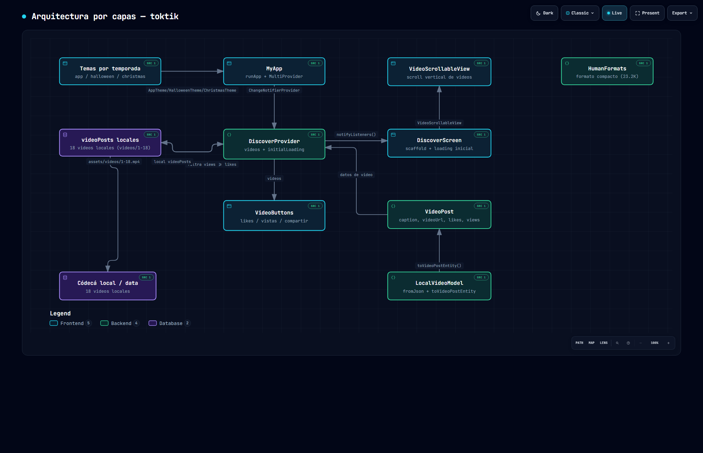
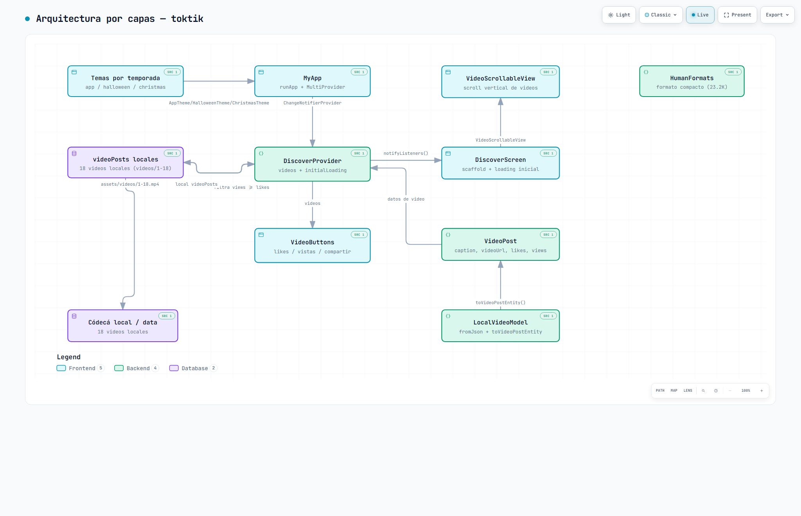
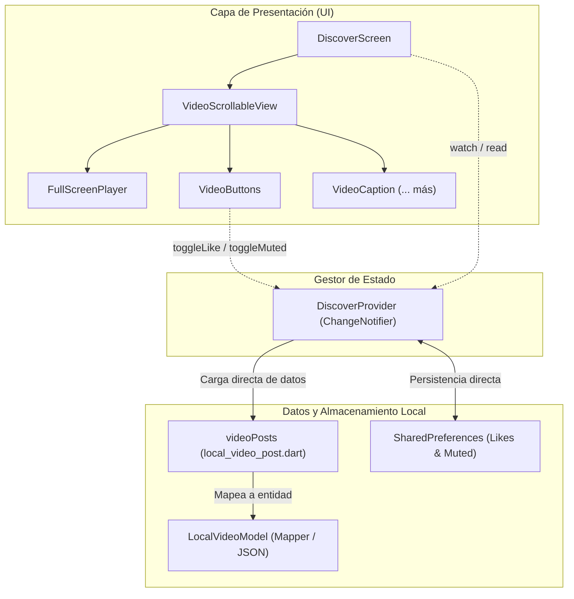

# Diagrama 1: Arquitectura con Provider Local (Archify)

> 🌐 **Visor Interactivo en GitHub Pages:** [https://jesuuusart.github.io/Practicas_DMI_220772/Practica04/toktik/Docs/Architecture/toktik_architecture.html](https://jesuuusart.github.io/Practicas_DMI_220772/Practica04/toktik/Docs/Architecture/toktik_architecture.html)  
> 📊 **Formato de Especificación:** [toktik.architecture.json](toktik.architecture.json)

  

---

## Descripción Técnica
En este esquema básico inicial, la interfaz de usuario se comunica directamente con el `DiscoverProvider`. El Provider accede de forma directa a los datos locales sin una capa intermedia de abstracción ni contratos de interfaz.

### Características del Diagrama 1:
- **Flujo directo:** El Provider tiene conocimiento explícito de la fuente de datos en memoria o assets.
- **Acoplamiento fuerte:** Cambiar o añadir una nueva fuente de datos requiere modificar la lógica interna del Provider.
- **Ideal para:** Prototipos rápidos y aplicaciones sencillas con una sola fuente fija de información.
