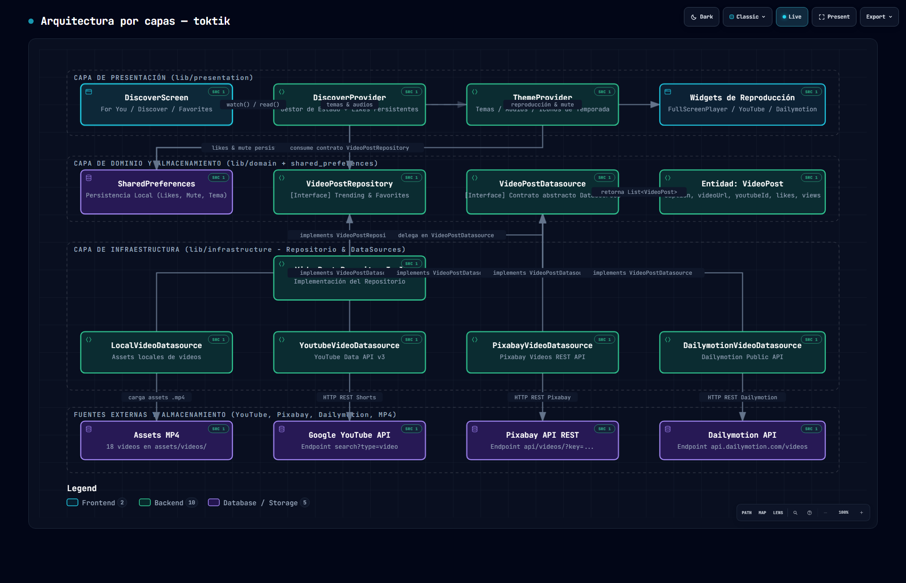
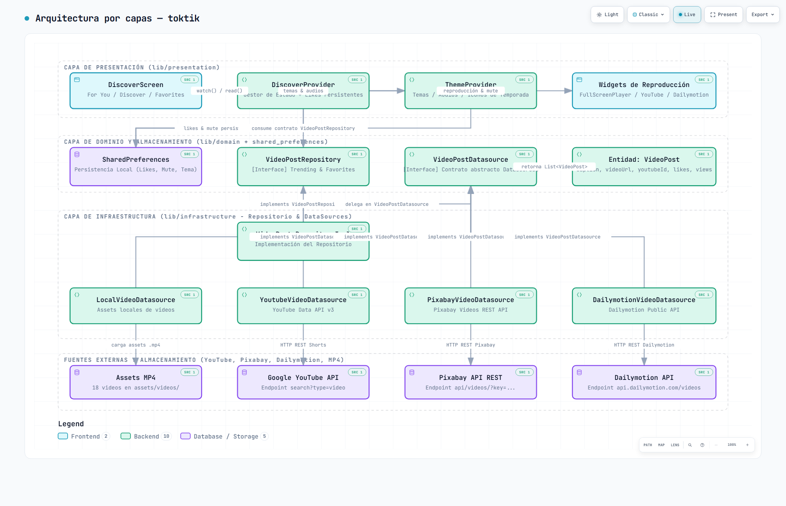
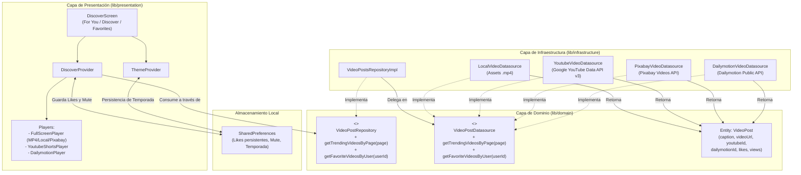

# Diagrama 2: Clean Architecture con Repositorio y Múltiples DataSources (Archify)

> 🌐 **Visor Interactivo en GitHub Pages:** [https://jesuuusart.github.io/Practicas_DMI_220772/Practica04/toktik/Docs/Architecture/toktik_clean_architecture.html](https://jesuuusart.github.io/Practicas_DMI_220772/Practica04/toktik/Docs/Architecture/toktik_clean_architecture.html)  
> 📊 **Formato de Especificación:** [toktik_clean.architecture.json](toktik_clean.architecture.json)

  

---

## Descripción Técnica
En este esquema profesional basado en **Clean Architecture**, se introducen las capas de **Dominio** e **Infraestructura**, desacoplando totalmente la interfaz gráfica de los orígenes de datos mediante el principio de inversión de dependencias y el patrón Repositorio.

### Características del Diagrama 2:
- **Inversión de dependencias:** La capa de presentación y el Provider solo conocen las interfaces abstractas de la capa de dominio (`VideoPostRepository` y `VideoPostDatasource`).
- **Múltiples DataSources simultáneos:** Se integran 3 APIs remotas diferentes (**YouTube**, **Pixabay**, **Dailymotion**) más la fuente **Local de Assets**, todas cumpliendo el mismo contrato.
- **Escalabilidad:** Agregar un nuevo proveedor de video (por ejemplo Vimeo o TikTok API) solo requiere crear una clase que implemente `VideoPostDatasource`, sin tocar la interfaz ni el estado.
- **Separación de responsabilidades:** Cada componente tiene una única función bien definida, facilitando pruebas unitarias y mantenimiento.
