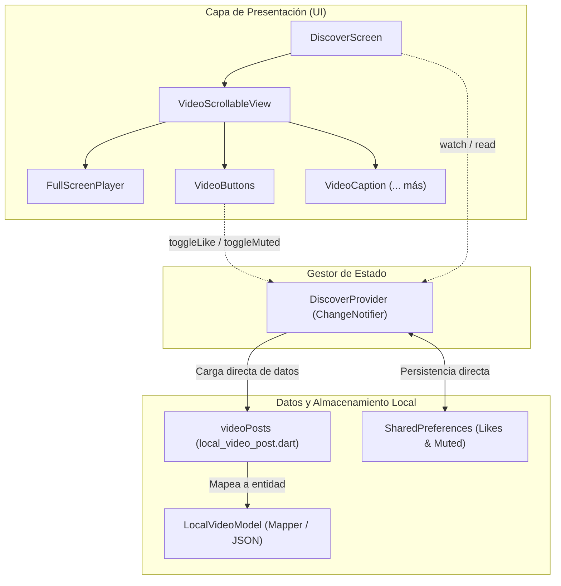
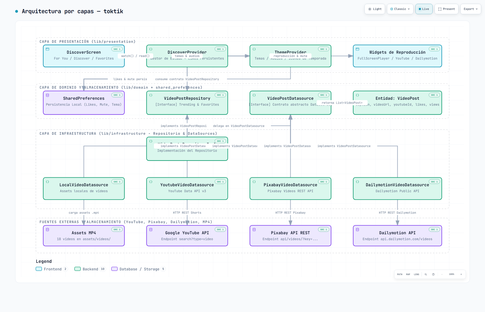
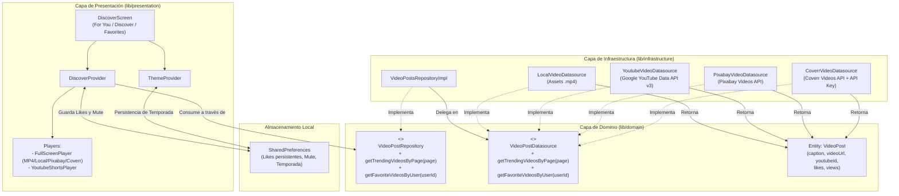

# Práctica 04: TokTik — Aplicación de Reproducción de Videos Verticales

> **Materia:** Desarrollo Móvil Integral (DMI) — (30 Firmas)  
> **Estudiante:** Jesus Alejandro Artiaga Morales  
> **Matrícula:** 220772 (10º A)  
> **Docente:** M.T.I. Marco A. Rentería Hernández  
> **Periodo:** Septiembre — Diciembre 2026  

---

<div align="center">

[](https://jesuuusart.github.io/Practicas_DMI_220772/)

  🔗 **[https://jesuuusart.github.io/Practicas_DMI_220772/](https://jesuuusart.github.io/Practicas_DMI_220772/)**
</div>

---

## 1. Descripción de la Práctica

Aplicación móvil desarrollada en Flutter que simula la experiencia de la red social **TikTok** con reproducción continua de videos en desplazamiento vertical. El proyecto está construido bajo los principios de **Clean Architecture**, incorporando:

- **Widgets Stateless y Stateful**
- **Gestores de Estado:** Providers (`provider`)
- **Manejo de Assets:** Videos, audios, iconos y tipografías personalizadas
- **Paquetes externos:** `video_player`, `youtube_player_flutter`, `audioplayers`, `shared_preferences`, etc.
- **Consumo de APIs con Key:** YouTube Data API v3, Pixabay Videos API y Coverr Videos API (autenticación por `Bearer`).
- **GestureDetector:** Para reproducir/pausar, dar like, silenciar y expandir descripciones.
- **Posicionamiento de Widgets y Stacks:** Superposición de controles, degradados (`LinearGradient`) y animaciones.
- **Mappers y Aserciones:** Transformación segura de modelos a entidades de dominio con `assert`.
- **Loops y Filtros:** Animaciones cíclicas de temporadas y filtrado dinámico de videos (`views > likes`).

---

## 2. Funcionalidades Específicas Implementadas

### 🎃 🎄 💖 🟣 A. Temas Visuales y Auditivos por Temporada
- **4 Temporadas completas:**
  - **Halloween:** Fuente *Creepster*, paleta naranja/negra, audio ambiental `halloween.mp3`, icono `halloween.png` y animación de calabazas/murciélagos.
  - **Navidad:** Fuente *Mountains of Christmas*, paleta roja/verde, audio navideño `navidad.mp3`, icono `navidad.png` y copos de nieve cayendo.
  - **San Valentín (Valentine's Day):** Fuente *Dancing Script*, paleta rosa/rojo pasión, audio romántico `valentines.mp3`, icono `valentines.png` y lluvia de corazones neón.
  - **Normal:** Fuente *Poppins*, paleta púrpura oscuro y audio original.
- **Carga automática por fecha:** Detecta el mes actual del dispositivo (Octubre = Halloween, Diciembre = Navidad, Febrero = San Valentín).
- **Mecanismo de prueba interactivo:** Menú accesible desde la barra superior para forzar cualquier temporada en tiempo de ejecución, persistido en **Local Storage** (`SharedPreferences`).

### 📱 B. Secciones Discover / For You / Favorites (Desplazamiento Lateral)
- **Navegación horizontal fluida (`TabBarView`):**
  1. **Para ti (For You):** Videos destacados locales y recomendaciones.
  2. **Descubrir (Discover):** Exploración de videos remotos con chips de filtro por API:
     - *Todos*
     - *YouTube Shorts*
     - *Pixabay Videos*
     - *Coverr (stock HD/4K, con preferencia por videos verticales)*
  3. **Favoritos (Favorites):** Feed dinámico que muestra exclusivamente los videos marcados con corazón.

### 🔇 C. Muteado y Activación de Sonido
- Botón interactivo de volumen en la columna derecha de la interfaz.
- Sincronizado en tiempo real con los reproductores (`VideoPlayerController` y `YoutubePlayerController`).
- Al usar MP4 directos (Coverr, Pixabay y assets locales) el volumen cambia **al instante**, sin recargar el video.
- Estado de silencio persistido en `SharedPreferences`.

### ❤️ D. Persistencia de "Me Gusta" (Local Storage)
- Al marcar el corazón, incrementa en 1 los likes y actualiza el estado `liked`.
- Al desmarcarlo, resta 1 like.
- Los datos persisten parcialmente en el dispositivo mediante `SharedPreferences`, sobreviviendo al reinicio de la aplicación.
- Nota: la API de Coverr no expone "me gusta", por lo que su datasource genera una cifra **determinista** (misma para el mismo video) a partir del `id`, la cual queda persistida en Local Storage desde la primera carga.

### 📜 E. Descripción Extensa con (... más) y Desplazamiento Vertical
- Si la descripción del video excede el límite de caracteres o 2 líneas, muestra automáticamente el indicador interactivo `... más`.
- Al pulsar `... más`, la descripción se expande en un contenedor con **desplazamiento vertical** (`SingleChildScrollView` con scrollbar visible), permitiendo leer captions largos sin desbordar la pantalla.
- Se puede contraer de nuevo con `menos`.

### 🌐 F. Consumo de 3 DataSources / APIs Remotas Diferentes
Arquitectura multicapa desacoplada consumiendo:
1. **YouTube Data API v3** (`YoutubeVideoDatasource`)
2. **Pixabay Videos API** (`PixabayVideoDatasource`)
3. **Coverr Videos API** (`CoverrVideoDatasource`, autenticada con API Key vía `Authorization: Bearer`)
4. **Local Assets DataSource** (`LocalVideoDatasource`)

---

## 3. Diagramas de Arquitectura (Archify)

📄 *Para la documentación técnica extendida, consulta: [DIAGRAMAS_ARQUITECTURA.md](Docs/Architecture/DIAGRAMAS_ARQUITECTURA.md).*

> 🌐 **Visores Dinámicos en Vivo en GitHub Pages:**
> - 🏛️ [**Diagrama 1: Provider Local** — Ver interactivo en GitHub Pages](https://jesuuusart.github.io/Practicas_DMI_220772/Practica04/toktik/Docs/Architecture/toktik_architecture.html)
> - 🏗️ [**Diagrama 2: Clean Architecture con Repositorio y 3 APIs** — Ver interactivo en GitHub Pages](https://jesuuusart.github.io/Practicas_DMI_220772/Practica04/toktik/Docs/Architecture/toktik_clean_architecture.html)

### Diagrama 1: Arquitectura con Provider Local

<div align="center">
  <a href="https://jesuuusart.github.io/Practicas_DMI_220772/Practica04/toktik/Docs/Architecture/toktik_architecture.html" title="Haz clic para abrir el Diagrama 1 interactivo en GitHub Pages">
    
    
  </a>
  <p><em>👆 Haz clic en cualquiera de las imágenes para interactuar con el Diagrama 1 en GitHub Pages</em></p>
</div>

Muestra el flujo directo inicial donde la interfaz de usuario consume los datos a través del Provider conectado directamente al almacenamiento y assets locales:



---

### Diagrama 2: Arquitectura Clean Code con Repositorio y Múltiples DataSources

<div align="center">
  <a href="https://jesuuusart.github.io/Practicas_DMI_220772/Practica04/toktik/Docs/Architecture/toktik_clean_architecture.html" title="Haz clic para abrir el Diagrama 2 interactivo en GitHub Pages">
    
    
  </a>
  <p><em>👆 Haz clic en cualquiera de las imágenes para interactuar con el Diagrama 2 en GitHub Pages</em></p>
</div>

Muestra el desacoplamiento mediante **Inversión de Dependencias**, donde la Presentación solo interactúa con contratos de Dominio, y la Infraestructura implementa los DataSources para **YouTube, Pixabay, Coverr y Local**:



---

## 4. Tecnologías y Paquetes Utilizados

| Paquete / Tecnología | Versión | Propósito en el Proyecto |
| :--- | :---: | :--- |
| **Flutter** | `3.47.2` | Framework base para desarrollo multiplataforma. |
| **Dart** | `3.13.2` | Lenguaje de programación orientado a objetos. |
| **provider** | `^6.1.5+1` | Inyección de dependencias y reactividad (`DiscoverProvider`, `ThemeProvider`). |
| **video_player** | `^2.10.0` | Reproducción a pantalla completa de videos MP4 locales, de Pixabay y de Coverr. |
| **youtube_player_flutter** | `^9.1.1` | Reproducción nativa embebida de videos de YouTube Shorts. |
| **audioplayers** | `^6.8.1` | Reproducción de sonidos ambientales y transiciones por temporada. |
| **shared_preferences** | `^2.3.3` | Persistencia en Local Storage de likes, mute y tema seleccionado. |
| **animate_do** | `^4.0.0` | Micro-animaciones para el botón de me gusta y transiciones. |
| **intl** | `^0.20.2` | Formato legible compacto para números de likes y vistas (ej. 24.5K). |
| **http** | `^1.6.0` | Peticiones HTTP a las APIs de YouTube, Pixabay y Coverr. |
| **Coverr Videos API** | `v1` | API de stock (HD/4K) autenticada con API Key; devuelve MP4 firmados y el flag `is_vertical`. |

---

## 5. Instrucciones de Ejecución

```bash
# 1. Obtener dependencias
flutter pub get

# 2. Verificar análisis estático de código
flutter analyze

# 3. Ejecutar la aplicación en emulador o dispositivo
flutter run
```
