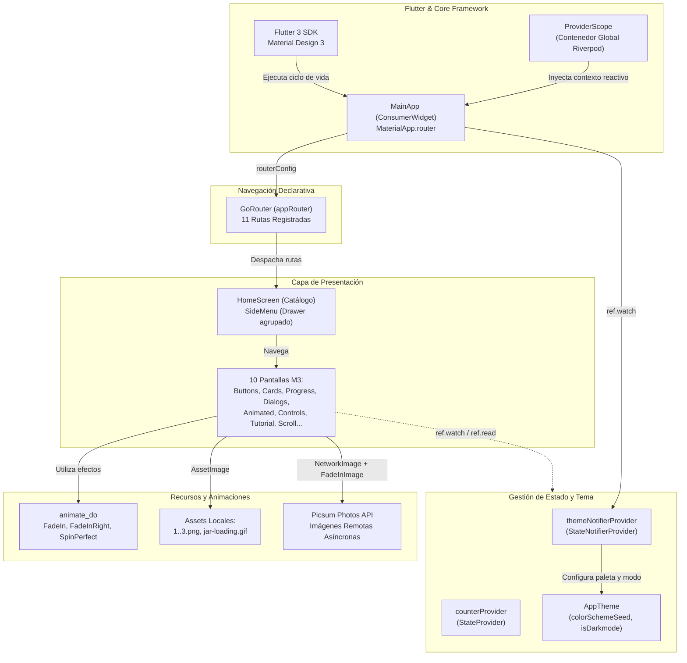
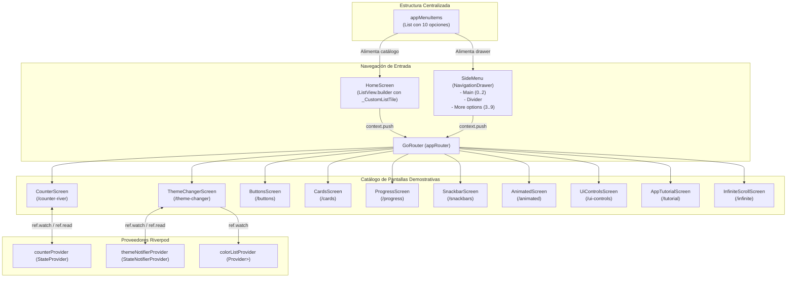

# Diagramas de Arquitectura (Archify) — Práctica 05: Widgets App

Este documento presenta los **2 diagramas de arquitectura interactivos** diseñados para la aplicación **Widgets App**, cumpliendo con los estándares de **OpenCode Archify** y los lineamientos de la Práctica 05:

> **🔗 Enlaces a los Diagramas Interactivos:**
> 1. 🏛️ **Diagrama 1: Arquitectura General Tecnológica** — [Abrir widgets_app_general_architecture.html](widgets_app_general_architecture.html) | [Especificación JSON](widgets_app_general.architecture.json) | [Doc Individual](DIAGRAMA_1_ARQUITECTURA_GENERAL.md)
> 2. 🏗️ **Diagrama 2: Arquitectura Específica de Pantallas, Rutas y Estados** — [Abrir widgets_app_specific_architecture.html](widgets_app_specific_architecture.html) | [Especificación JSON](widgets_app_specific.architecture.json) | [Doc Individual](DIAGRAMA_2_ARQUITECTURA_ESPECIFICA.md)
> 
> 🌐 **Publicación en GitHub Pages:** [https://jesuuusart.github.io/Practicas_DMI_220772/](https://jesuuusart.github.io/Practicas_DMI_220772/)

---

## 1. Diagrama 1: Arquitectura General Tecnológica (Archify)

Representa las capas tecnológicas principales de la aplicación, el motor de navegación declarativa, el contenedor reactivo de estados con Riverpod, el sistema de diseño Material 3 y los recursos multimedia locales y remotos.

### Características del Diagrama 1:
- **Gestión reactiva desacoplada:** El uso de `ProviderScope` en la cúspide del árbol permite que cualquier widget (`ConsumerWidget`) acceda al estado sin propagar `InheritedWidget` manualmente.
- **Tema Dinámico Global:** `ThemeNotifier` altera el `ColorSchemeSeed` y el brillo en tiempo de ejecución, actualizando `MaterialApp.router` instantáneamente.
- **Navegación Declarativa:** La pila de navegación es administrada centralmente por `GoRouter`, facilitando enlaces profundos y modularidad.

---

## 2. Diagrama 2: Arquitectura Específica de Pantallas, Rutas y Estados (Archify)

Detalla la estructura de datos centralizada de navegación, el menú lateral con opciones agrupadas, cada una de las 11 pantallas implementadas y sus interacciones con los proveedores de estado de Riverpod.

### Características del Diagrama 2:
- **Centralización del Menú:** La lista `appMenuItems` sirve como única fuente de verdad para el `ListView` de `HomeScreen` y el `NavigationDrawer` de `SideMenu`.
- **Especialización de Widgets:** Pantallas complejas como `AppTutorialScreen` (`PageView` + `PageController`) e `InfiniteScrollScreen` (`ScrollController` + `RefreshIndicator`) encapsulan su lógica interna manteniendo contratos limpios.
- **Separación de Responsabilidades:** Componentes reutilizables como `CustomButton`, `_CardType1..4`, y `_Slide` facilitan el mantenimiento del código.
