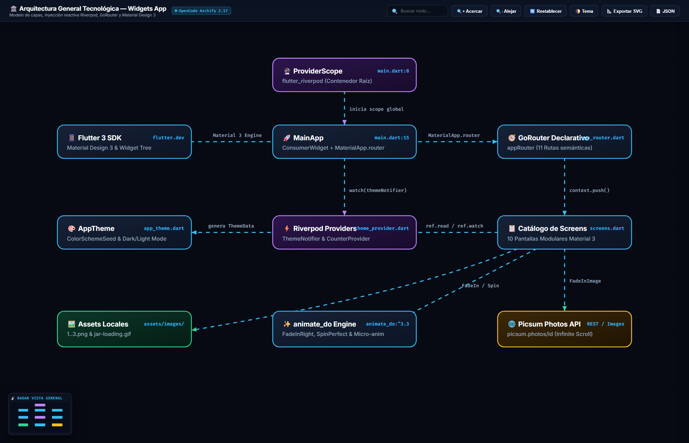
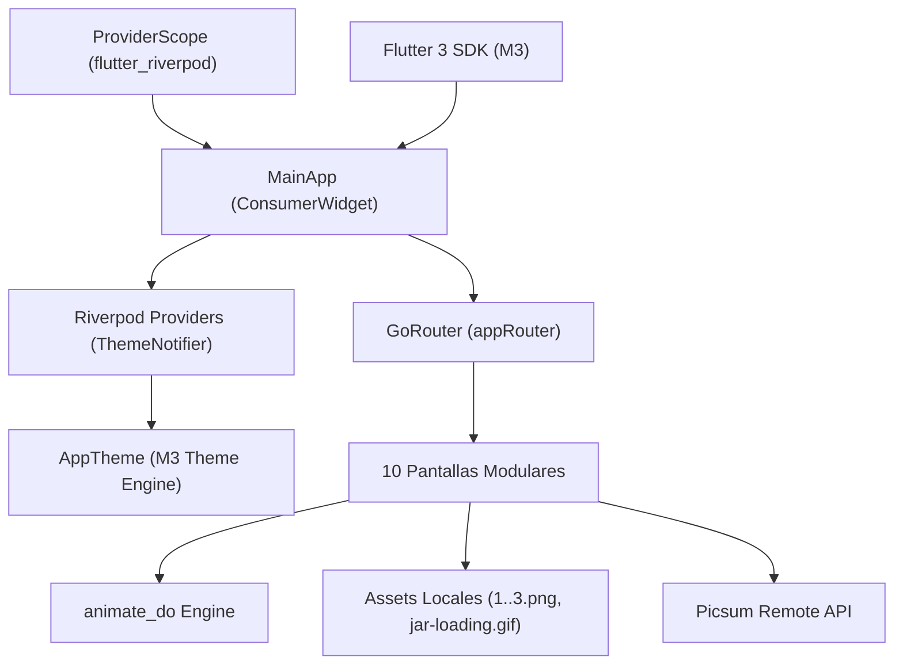

# Diagrama 1: Arquitectura General Tecnológica — Widgets App

## 🌐 Enlaces Interactivos
- 🔗 **Diagrama Interactivo en GitHub Pages:** [https://jesuuusart.github.io/Practicas_DMI_220772/Practica05/widgets_app/Docs/Architecture/widgets_app_general_architecture.html](https://jesuuusart.github.io/Practicas_DMI_220772/Practica05/widgets_app/Docs/Architecture/widgets_app_general_architecture.html)
- 🔗 **Archivo HTML Local (Archify):** [widgets_app_general_architecture.html](widgets_app_general_architecture.html)
- 📄 **Especificación JSON:** [widgets_app_general.architecture.json](widgets_app_general.architecture.json)
- 📱 **Demostración en Appetize.io:** [https://appetize.io/app/b_bwtrb7oou2e5asilzdeknfzwi4](https://appetize.io/app/b_bwtrb7oou2e5asilzdeknfzwi4)
- 🌐 **Portafolio en GitHub Pages:** [https://jesuuusart.github.io/Practicas_DMI_220772/](https://jesuuusart.github.io/Practicas_DMI_220772/)

---

## 🖼️ Previsualización Interactiva (Clic para abrir en GitHub Pages)

  

---

## 🏛️ Descripción del Diagrama

Este diagrama modela la infraestructura tecnológica completa de la aplicación **Widgets App**, construida sobre Flutter y Dart siguiendo los lineamientos de Material Design 3.

### Componentes Clave:
1. **`ProviderScope`**: Inyectado en el método `main()` de `lib/main.dart` para almacenar todos los providers y permitir su lectura reactiva.
2. **`MainApp (ConsumerWidget)`**: Widget raíz que escucha cambios en el `themeNotifierProvider` para reconstruir dinámicamente el `MaterialApp.router` ante cualquier cambio de color o modo oscuro.
3. **`GoRouter`**: Administrador de rutas declarativo que mapea URLs limpias (`/buttons`, `/cards`, etc.) a sus respectivos constructores de widgets.
4. **`AppTheme`**: Clase inmutable de configuración que expone una paleta personalizada de 9 colores preestablecidos y genera instancias de `ThemeData` con `useMaterial3: true`.
5. **`animate_do`**: Motor de animaciones utilizado en la pantalla de bienvenida (`FadeInRight`) y el indicador flotante de carga en el scroll infinito (`SpinPerfect`).
