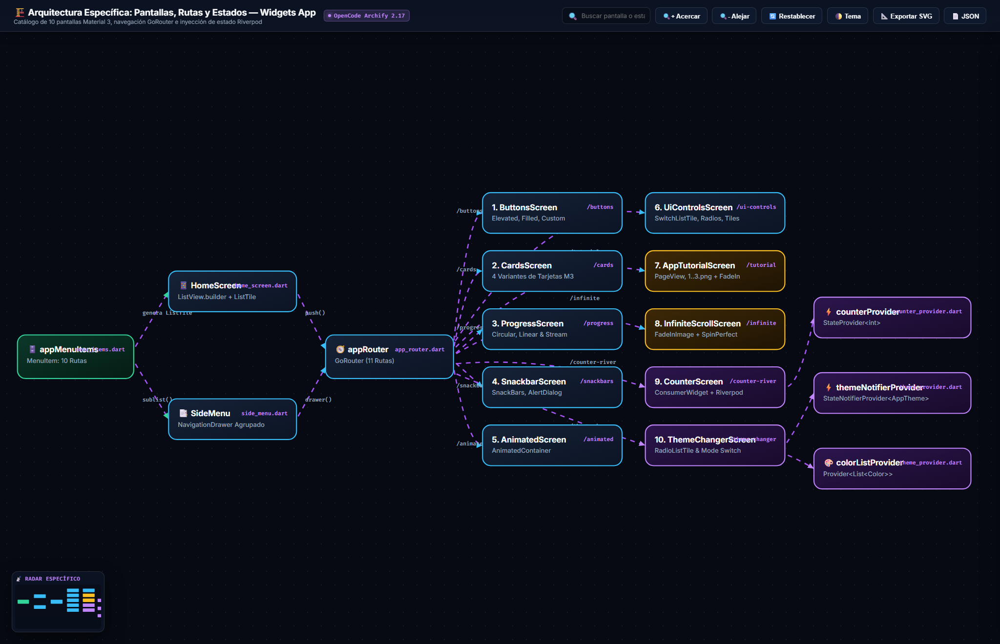
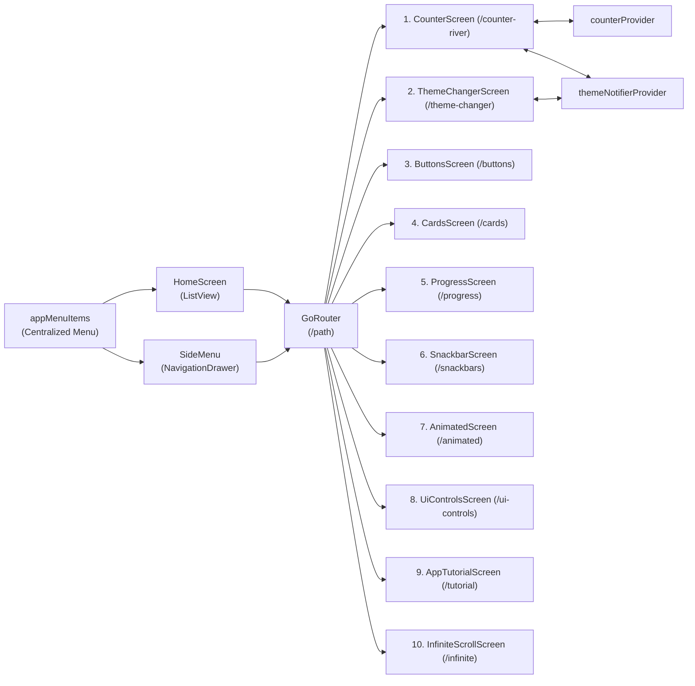

# Diagrama 2: Arquitectura Específica de Pantallas, Rutas y Estados — Widgets App

## 🌐 Enlaces Interactivos
- 🔗 **Diagrama Interactivo en GitHub Pages:** [https://jesuuusart.github.io/Practicas_DMI_220772/Practica05/widgets_app/Docs/Architecture/widgets_app_specific_architecture.html](https://jesuuusart.github.io/Practicas_DMI_220772/Practica05/widgets_app/Docs/Architecture/widgets_app_specific_architecture.html)
- 🔗 **Archivo HTML Local (Archify):** [widgets_app_specific_architecture.html](widgets_app_specific_architecture.html)
- 📄 **Especificación JSON:** [widgets_app_specific.architecture.json](widgets_app_specific.architecture.json)
- 📱 **Demostración en Appetize.io:** [https://appetize.io/app/b_bwtrb7oou2e5asilzdeknfzwi4](https://appetize.io/app/b_bwtrb7oou2e5asilzdeknfzwi4)
- 🌐 **Portafolio en GitHub Pages:** [https://jesuuusart.github.io/Practicas_DMI_220772/](https://jesuuusart.github.io/Practicas_DMI_220772/)

---

## 🖼️ Previsualización Interactiva (Clic para abrir en GitHub Pages)

  

---

## 🏗️ Descripción del Diagrama

Detalla cómo se organiza el flujo de navegación de la aplicación a partir de la fuente centralizada de datos (`appMenuItems`), la pantalla de inicio (`HomeScreen`), el menú lateral (`SideMenu`), y el despacho hacia las 10 pantallas individuales implementadas.

### Pantallas y Componentes Implementados:
1. **`HomeScreen`**: Lista de tarjetas con `ListTile`, íconos primarios y flechas indicadoras, consumiendo `appMenuItems`.
2. **`SideMenu`**: Drawer con header, opciones principales (`sublist(0, 3)`), divisor (`Divider`), y opciones secundarias (`sublist(3)`).
3. **`ButtonsScreen`**: Muestra `ElevatedButton`, `FilledButton`, `OutlinedButton`, `TextButton`, `IconButton`, y un `CustomButton` construido sobre `Material` e `InkWell` con `ClipRRect`.
4. **`CardsScreen`**: 4 tipos de tarjetas explorando elevación, bordes con `colors.outline`, superficies de color (`colors.surfaceContainerHighest`) e imágenes de Picsum.
5. **`ProgressScreen`**: Indicadores indeterminados y controlados generados a partir de un flujo de `Stream.periodic` con `StreamBuilder`.
6. **`SnackbarScreen`**: Retroalimentación mediante `SnackBar` con acciones, `showAboutDialog` y `AlertDialog` con confirmación.
7. **`AnimatedScreen`**: Animaciones implícitas en `AnimatedContainer` con propiedades aleatorias y `Curves.elasticOut`.
8. **`UiControlsScreen`**: Controles de selección agrupados con `SwitchListTile`, `ExpansionTile`, `RadioListTile` (utilizando `enum Transportation`) y `CheckboxListTile`.
9. **`AppTutorialScreen`**: Secuencia de bienvenida con `PageView`, `PageController`, imágenes locales y botón animado con `FadeInRight` de `animate_do`.
10. **`InfiniteScrollScreen`**: Lista con `ScrollController`, carga asíncrona al llegar al final del scroll, `RefreshIndicator` para Pull to Refresh y `FadeInImage` con `jar-loading.gif`.
