# Práctica 05: Widgets App — Catálogo de Material Design 3

> **Materia:** Desarrollo Móvil Integral (DMI) — (40 Firmas)  
> **Estudiante:** Jesus Alejandro Artiaga Morales  
> **Matrícula:** 220772 (10º A)  
> **Docente:** M.T.I. Marco A. Ramírez Hernández  
> **Periodo:** Septiembre — Diciembre 2026  

---

<div align="center">
  

  <br /><br />

  [](https://jesuuusart.github.io/Practicas_DMI_220772/)
  [](https://appetize.io/app/b_bwtrb7oou2e5asilzdeknfzwi4)
  [](https://flutter.dev)
  [](https://dart.dev)
  [](https://riverpod.dev)
  [](https://pub.dev/packages/go_router)
  [](https://m3.material.io)

  📱 **[Probar Widgets App en Vivo en Appetize.io](https://appetize.io/app/b_bwtrb7oou2e5asilzdeknfzwi4)** | 🌐 **[Portafolio Web y Diagramas en GitHub Pages](https://jesuuusart.github.io/Practicas_DMI_220772/)**
</div>

---

## 1. 📖 Descripción del Proyecto

**Widgets App** es una aplicación móvil desarrollada en **Flutter** y **Dart** diseñada para explorar, implementar y documentar componentes visuales e interactivos de **Material Design 3**. La aplicación organiza un catálogo integral de pantallas demostrativas mediante un sistema de navegación declarativa con **GoRouter** y una arquitectura de gestión reactiva del estado impulsada por **Flutter Riverpod**.

La aplicación incorpora:
- **Botones interactivos y personalizados:** Variantes estándar de Material 3 (`ElevatedButton`, `FilledButton`, `OutlinedButton`, `TextButton`, `IconButton`, `FloatingActionButton`) y un componente propio construido con `Material`, `InkWell` y `ClipRRect`.
- **Tarjetas multi-estilo (`Card`):** Elevación progresiva (niveles 0 a 5), bordes perimetrales (`colors.outline`), superficies rellenas (`surfaceContainerHighest`) y tarjetas con imágenes remotas de Picsum.
- **Indicadores de progreso:** Indicadores circulares y lineales tanto indeterminados como controlados en tiempo real mediante `Stream.periodic` y `StreamBuilder`.
- **Notificaciones y cuadros de diálogo:** Retroalimentación mediante `SnackBar` y `ScaffoldMessenger`, diálogo de licencias con `showAboutDialog` y diálogos modales de confirmación/cancelación con `AlertDialog` y `showDialog`.
- **Animaciones implícitas:** Pantalla interactiva con `AnimatedContainer` y `StatefulWidget` que transforma aleatoriamente ancho, alto, color y radio de bordes con `Random` y curva física `Curves.elasticOut`.
- **Controles de selección y formularios:** Interruptor `SwitchListTile`, panel desplegable `ExpansionTile`, selección única con `RadioListTile` tipada con `enum Transportation` y selección múltiple con `CheckboxListTile`.
- **Tutorial introductorio:** Secuencia de bienvenida deslizable con `PageView` y `PageController`, recursos gráficos locales (`1.png`, `2.png`, `3.png`) y aparición animada del botón de inicio mediante `FadeInRight` de `animate_do`.
- **Desplazamiento infinito y Pull to Refresh:** Lista asíncrona con `ListView.builder` y `ScrollController`, carga progresiva de imágenes remotas con `FadeInImage`, placeholder animado `jar-loading.gif`, actualización mediante gesto vertical con `RefreshIndicator` y animación `SpinPerfect`.
- **Gestión reactiva del estado y temas con Riverpod:** Contador reactivo con `StateProvider` y personalización dinámica del tema global (modo claro/oscuro y 9 paletas de colores) mediante `StateNotifierProvider` y `ThemeNotifier`.

---

## 2. 🎯 Objetivo de la Práctica

Diseñar y desarrollar una aplicación móvil multiplataforma mediante Flutter y Dart, implementando widgets de Material Design 3, navegación declarativa con GoRouter, administración del estado con Riverpod y animaciones interactivas, con la finalidad de fortalecer las competencias en el diseño de interfaces gráficas, modularización del código, interacción con el usuario, documentación de arquitectura y distribución de aplicaciones móviles.

---

## 3. 📋 Matriz de Cumplimiento de Actividades (1 a 20)

| No. | Actividad | Estatus | Evidencia / Implementación |
|:---:|:---|:---:|:---|
| **1** | **Creación y configuración del proyecto** | 🟢 Concluida | Proyecto `widgets_app` con dependencias `go_router`, `flutter_riverpod`, `animate_do` y registro de carpeta `assets/images/` en [pubspec.yaml](pubspec.yaml). |
| **2** | **Organización modular de la arquitectura** | 🟢 Concluida | Separación de responsabilidades en `lib/config/` (`menu`, `router`, `theme`) y `lib/presentation/` (`providers`, `screen`, `widgets`). |
| **3** | **Configuración de Material Design 3** | 🟢 Concluida | Clase [`AppTheme`](lib/config/theme/app_theme.dart) con `useMaterial3: true`, paleta de 9 colores, soporte claro/oscuro y método `copyWith()`. |
| **4** | **Navegación declarativa (GoRouter)** | 🟢 Concluida | Configuración de 11 rutas en [`app_router.dart`](lib/config/router/app_router.dart) y `MaterialApp.router` en [`main.dart`](lib/main.dart) con `context.push()` y `context.pop()`. |
| **5** | **Construcción de la pantalla principal** | 🟢 Concluida | [`HomeScreen`](lib/presentation/screen/home/home_screen.dart) con `Scaffold`, `AppBar`, `ListView.builder` y `_CustomListTile` consumiendo `appMenuItems`. |
| **6** | **Implementación del menú lateral** | 🟢 Concluida | [`SideMenu`](lib/presentation/widgets/side_menu.dart) con `NavigationDrawer`, opciones agrupadas (`sublist(0, 3)` y `sublist(3)`), `Divider` e iconos. |
| **7** | **Exploración de widgets de botones** | 🟢 Concluida | [`ButtonsScreen`](lib/presentation/screen/buttons/buttons_screen.dart) con `ElevatedButton`, `FilledButton`, `OutlinedButton`, `TextButton`, `IconButton`, `FloatingActionButton` y `CustomButton` (`Material` + `InkWell`). |
| **8** | **Diseño de tarjetas (`Card`)** | 🟢 Concluida | [`CardsScreen`](lib/presentation/screen/cards/cards_screen.dart) con 4 variantes: elevaciones (0 a 5), bordes (`outline`), rellenas (`surfaceContainerHighest`) e imágenes remotas. |
| **9** | **Indicadores de progreso** | 🟢 Concluida | [`ProgressScreen`](lib/presentation/screen/progress/progress_screen.dart) con `CircularProgressIndicator` y `LinearProgressIndicator` indeterminados y controlados con `Stream.periodic` + `StreamBuilder`. |
| **10** | **Gestión de notificaciones y cuadros de diálogo** | 🟢 Concluida | [`SnackbarScreen`](lib/presentation/screen/snackbar/snackbar_screen.dart) con `SnackBar`, `ScaffoldMessenger`, `AlertDialog`, `showDialog` y `showAboutDialog`. |
| **11** | **Implementación de animaciones implícitas** | 🟢 Concluida | [`AnimatedScreen`](lib/presentation/screen/animated/animated_screen.dart) con `AnimatedContainer`, `StatefulWidget`, valores aleatorios (`Random`) y curva `Curves.elasticOut`. |
| **12** | **Construcción de controles interactivos** | 🟢 Concluida | [`UiControlsScreen`](lib/presentation/screen/ui_controls/ui_controls_screen.dart) con `SwitchListTile`, `ExpansionTile`, `RadioListTile` (`enum Transportation`) y `CheckboxListTile`. |
| **13** | **Desarrollo de un tutorial introductorio** | 🟢 Concluida | [`AppTutorialScreen`](lib/presentation/screen/app_tutorial/app_tutorial_screen.dart) con `PageView`, `PageController`, imágenes locales (`1.png`–`3.png`) y botón con `FadeInRight`. |
| **14** | **Implementación de desplazamiento infinito** | 🟢 Concluida | [`InfiniteScrollScreen`](lib/presentation/screen/infinite_scroll/infinite_scroll_screen.dart) con `ScrollController`, carga progresiva asíncrona y `FadeInImage` con `jar-loading.gif`. |
| **15** | **Actualización de contenido mediante gestos** | 🟢 Concluida | Pull to Refresh integrado mediante `RefreshIndicator` y animación de recarga con `SpinPerfect` en el FAB. |
| **16** | **Administración del estado con Riverpod** | 🟢 Concluida | `ProviderScope` en [`main.dart`](lib/main.dart) y [`CounterScreen`](lib/presentation/screen/counter/counter_screen.dart) con `ConsumerWidget`, `ref.watch()` y `ref.read()`. |
| **17** | **Personalización dinámica del tema** | 🟢 Concluida | [`ThemeNotifier`](lib/presentation/providers/theme_provider.dart) con `StateNotifierProvider`, selección de colores por `RadioListTile` y modo oscuro reflejado globalmente. |
| **18** | **Pruebas de integración y funcionamiento** | 🟢 Concluida | Ejecución verificada en emulador Android con 16 capturas de evidencia en [`assets/pruebas/`](assets/pruebas/) y smoke test en [`widget_test.dart`](test/widget_test.dart). |
| **19** | **Documentación de arquitectura mediante Archify** | 🟢 Concluida | 2 diagramas interactivos Archify (General y Específico) en formato HTML, JSON y PNG (modo claro y oscuro) en [`Docs/Architecture/`](Docs/Architecture/). |
| **20** | **Publicación y documentación del proyecto** | 🟢 Concluida | Código en GitHub, documentación en `README.md`, diagramas en [GitHub Pages](https://jesuuusart.github.io/Practicas_DMI_220772/) y demo en [Appetize.io](https://appetize.io/app/b_bwtrb7oou2e5asilzdeknfzwi4). |

---

## 4. 🏛️ Diagramas de Arquitectura Interactivos (Archify)

📄 *Para la documentación técnica detallada de ambos diagramas, consulta: [DIAGRAMAS_ARQUITECTURA.md](Docs/Architecture/DIAGRAMAS_ARQUITECTURA.md).*

> 🌐 **Enlaces Directos a los Visores Interactivos en GitHub Pages:**
> - 🏛️ [**Diagrama 1: Arquitectura General Tecnológica** — Abrir visor interactivo en GitHub Pages ↗](https://jesuuusart.github.io/Practicas_DMI_220772/Practica05/widgets_app/Docs/Architecture/widgets_app_general_architecture.html)
> - 🏗️ [**Diagrama 2: Arquitectura Específica de Pantallas, Rutas y Estados** — Abrir visor interactivo en GitHub Pages ↗](https://jesuuusart.github.io/Practicas_DMI_220772/Practica05/widgets_app/Docs/Architecture/widgets_app_specific_architecture.html)

---

### 🏛️ Diagrama 1: Arquitectura General Tecnológica

<div align="center">
  <a href="https://jesuuusart.github.io/Practicas_DMI_220772/Practica05/widgets_app/Docs/Architecture/widgets_app_general_architecture.html" title="Haz clic para abrir el Diagrama 1 interactivo en GitHub Pages">
    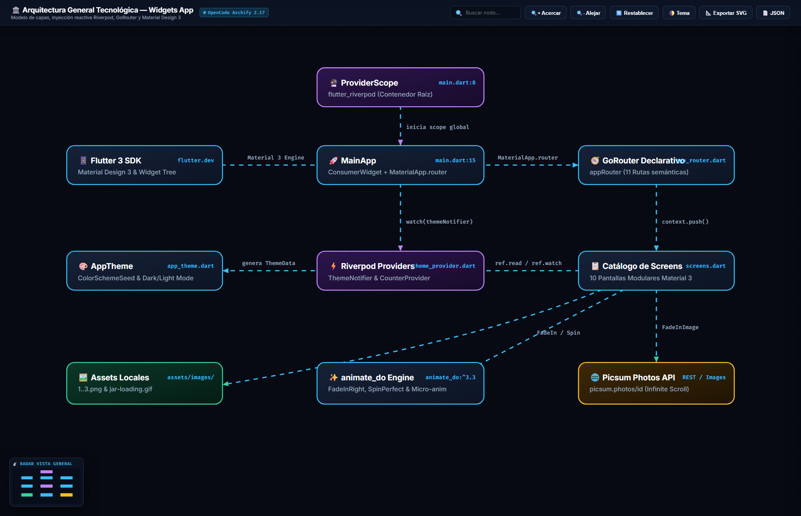
    
  </a>
  <p><em>👆 Haz clic en cualquiera de los diagramas para abrir el visor interactivo en GitHub Pages</em></p>
</div>

Representa los componentes tecnológicos principales de la aplicación: el contenedor global `ProviderScope`, `MainApp` con `MaterialApp.router`, el enrutador declarativo `GoRouter`, la gestión de estado y temas con `Riverpod` (`ThemeNotifier` y `AppTheme`), y la integración de recursos gráficos y animaciones (`animate_do`, assets locales y Picsum):

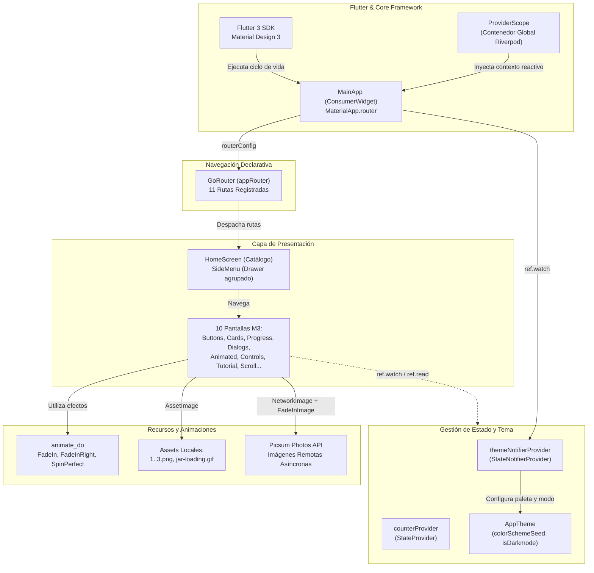

---

### 🏗️ Diagrama 2: Arquitectura Específica de Pantallas, Rutas y Estados

<div align="center">
  <a href="https://jesuuusart.github.io/Practicas_DMI_220772/Practica05/widgets_app/Docs/Architecture/widgets_app_specific_architecture.html" title="Haz clic para abrir el Diagrama 2 interactivo en GitHub Pages">
    
    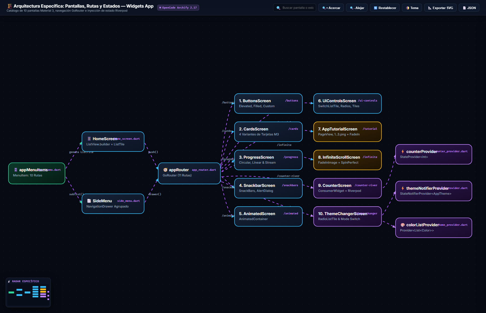
  </a>
  <p><em>👆 Haz clic en cualquiera de los diagramas para abrir el visor interactivo en GitHub Pages</em></p>
</div>

Detalla la estructura centralizada del menú (`appMenuItems`), su consumo en `HomeScreen` y `SideMenu`, las 11 rutas declaradas en `GoRouter` y la conexión reactiva con los proveedores de estado de Riverpod (`counterProvider`, `themeNotifierProvider` y `colorListProvider`):

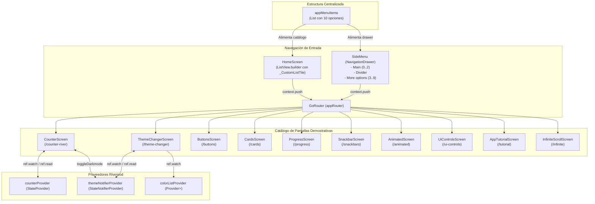

---

## 5. 📸 Galería de Evidencias de Funcionamiento (16 Capturas)

A continuación se muestran las **16 capturas de pantalla** tomadas durante la ejecución de **Widgets App** en el emulador Android, verificando cada una de las actividades solicitadas:

### 🏠 A. Navegación Principal, Menú Lateral y Gestión de Estado (Riverpod)

| 1. Pantalla Principal (`HomeScreen`) | 2. Menú Lateral (`SideMenu`) | 3. Contador Riverpod (`CounterScreen`) | 4. Tema Modo Claro (`ThemeChanger`) | 5. Tema Modo Oscuro (`ThemeChanger`) |
|:---:|:---:|:---:|:---:|:---:|
| 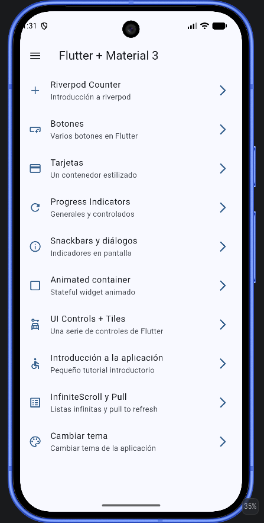 | 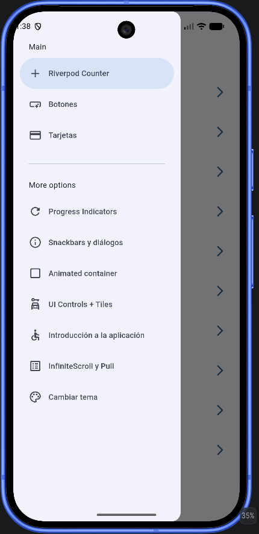 | 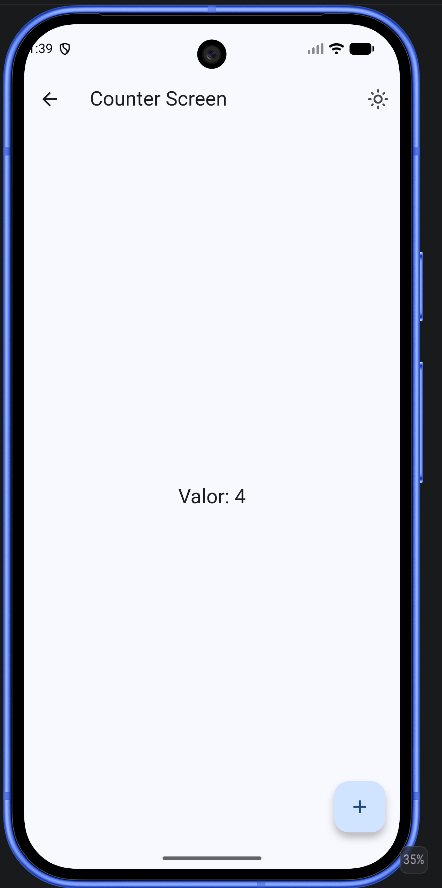 | 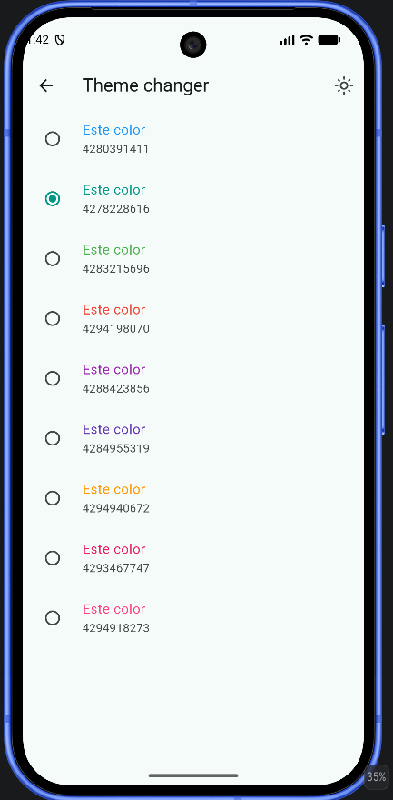 | 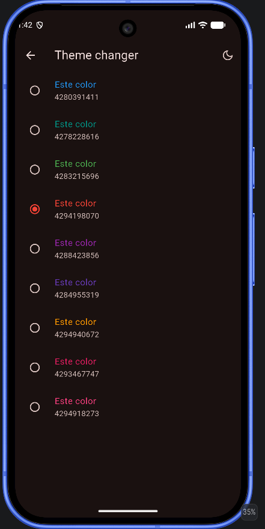 |
| *Catálogo centralizado de Material 3* | *`NavigationDrawer` con opciones agrupadas* | *`StateProvider` + switch de tema* | *Paleta de colores con `RadioListTile` (Claro)* | *`ThemeNotifier` en modo oscuro global* |

---

### 🧩 B. Botones, Tarjetas, Indicadores de Progreso y Notificaciones

| 6. Catálogo de Botones (`ButtonsScreen`) | 7. Diseño de Tarjetas (`CardsScreen`) | 8. Indicadores de Progreso (`ProgressScreen`) | 9. Notificación (`SnackBar`) | 10. Cuadro de Diálogo (`AlertDialog`) |
|:---:|:---:|:---:|:---:|:---:|
| 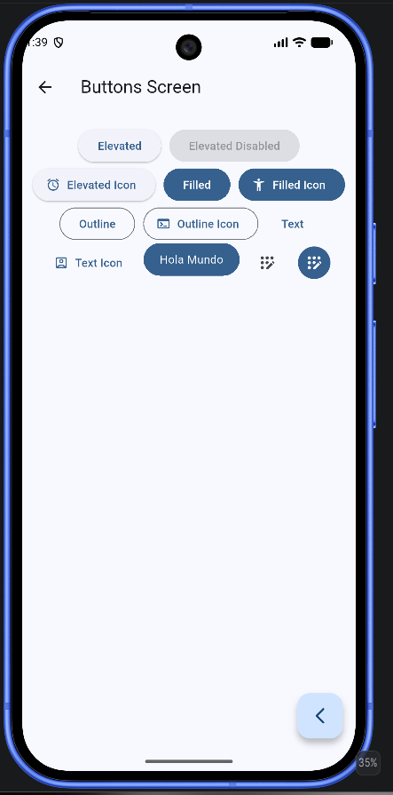 | 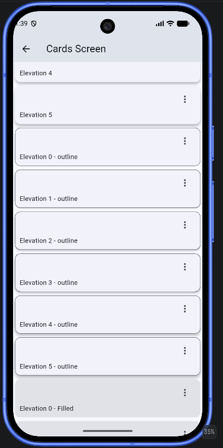 | 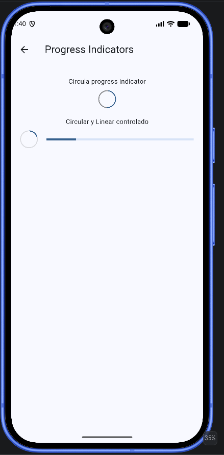 | 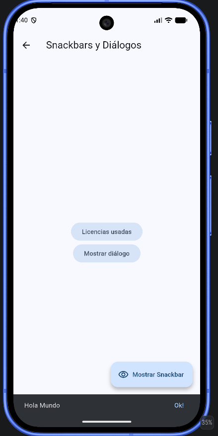 | 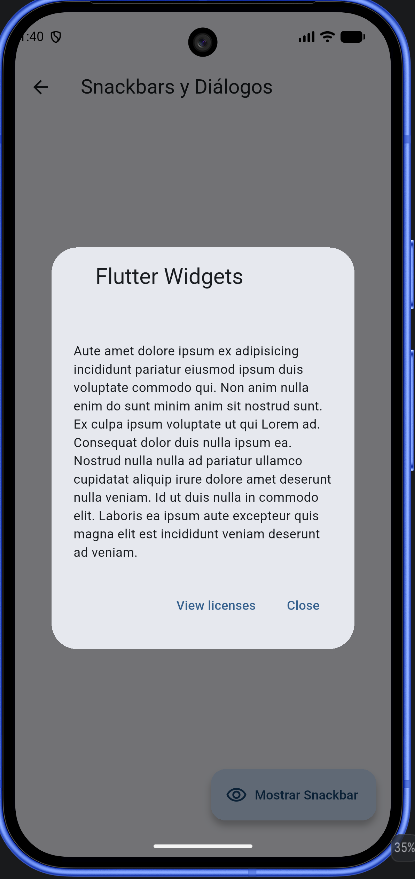 |
| *Variantes M3 + `CustomButton` (`InkWell`)* | *Elevaciones, bordes, rellenas e imagen* | *Indeterminado y controlado (`StreamBuilder`)* | *`ScaffoldMessenger` con acción `Ok!`* | *Diálogo modal con `Cancelar` y `Aceptar`* |

---

### ✨ C. Animaciones, Controles UI, Tutorial Introductorio e Infinite Scroll

| 11. Contenedor Animado (`AnimatedScreen`) | 12. Controles Interactivos (`UiControlsScreen`) | 13. Tutorial Slide 1 (`PageView`) | 14. Tutorial Slide Final (`FadeInRight`) | 15. Desplazamiento Infinito (`InfiniteScroll`) | 16. Pull to Refresh (`RefreshIndicator`) |
|:---:|:---:|:---:|:---:|:---:|:---:|
| 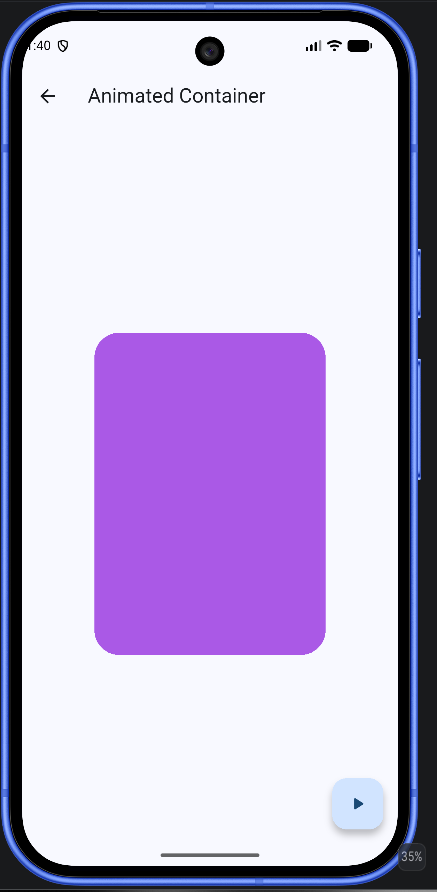 | 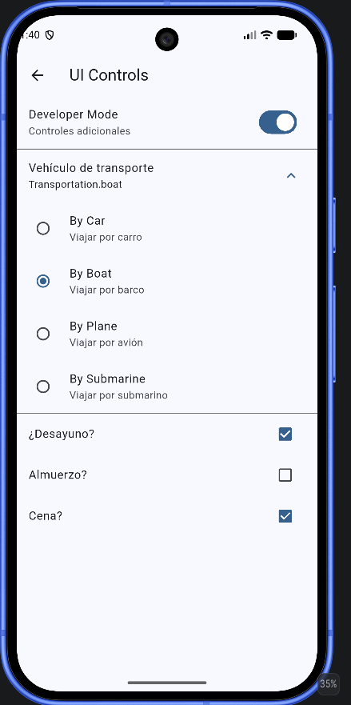 | 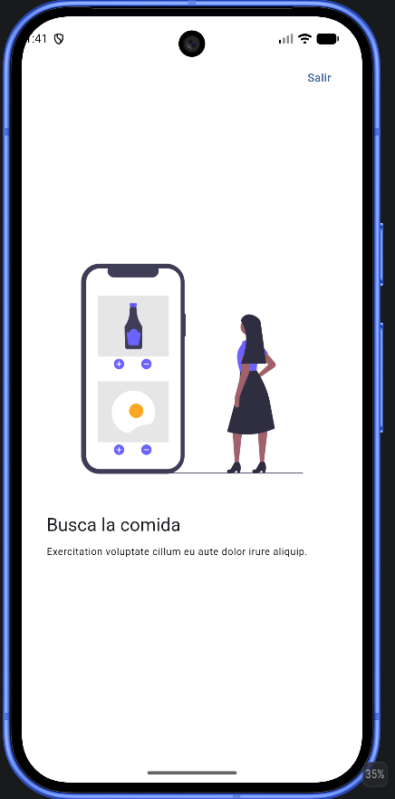 | 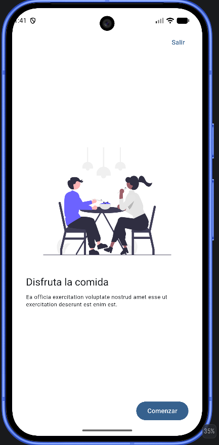 | 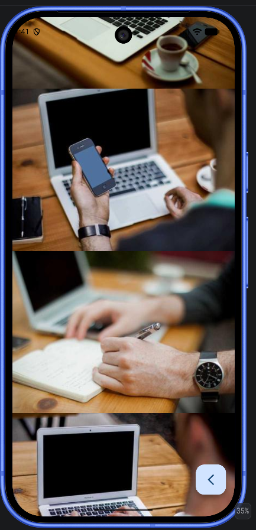 | 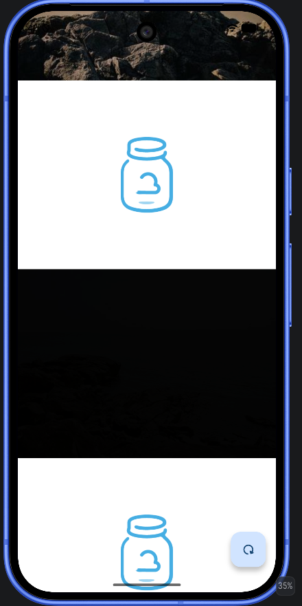 |
| *`AnimatedContainer` con `Curves.elasticOut`* | *Switch, Expansion, Radio (`enum`) y Checkboxes* | *Secuencia con assets locales* | *Botón "Comenzar" animado con `animate_do`* | *Carga asíncrona de imágenes Picsum* | *Gesto Pull to Refresh y `SpinPerfect`* |

---

## 6. 📂 Estructura de Directorios del Proyecto

```text
widgets_app/
├── assets/
│   ├── images/
│   │   ├── 1.png                           # Diapositiva 1 del tutorial
│   │   ├── 2.png                           # Diapositiva 2 del tutorial
│   │   ├── 3.png                           # Diapositiva 3 del tutorial
│   │   └── jar-loading.gif                 # Placeholder animado de carga
│   └── pruebas/                            # 16 capturas de evidencia de ejecución
├── Docs/
│   └── Architecture/
│       ├── DIAGRAMAS_ARQUITECTURA.md
│       ├── DIAGRAMA_1_ARQUITECTURA_GENERAL.md
│       ├── DIAGRAMA_2_ARQUITECTURA_ESPECIFICA.md
│       ├── widgets_app_general.architecture.json
│       ├── widgets_app_general_architecture.html
│       ├── widgets_app_general_architecture.visual-check.2048x1320.dark.png
│       ├── widgets_app_general_architecture.visual-check.2048x1320.light.png
│       ├── widgets_app_specific.architecture.json
│       ├── widgets_app_specific_architecture.html
│       ├── widgets_app_specific_architecture.visual-check.2048x1320.dark.png
│       └── widgets_app_specific_architecture.visual-check.2048x1320.light.png
├── lib/
│   ├── config/
│   │   ├── menu/
│   │   │   └── menu_items.dart             # Catálogo centralizado (10 elementos)
│   │   ├── router/
│   │   │   └── app_router.dart             # GoRouter con 11 rutas declarativas
│   │   └── theme/
│   │       └── app_theme.dart              # Motor de tema Material 3 (9 colores + Dark/Light)
│   ├── presentation/
│   │   ├── providers/
│   │   │   ├── counter_provider.dart       # StateProvider<int>
│   │   │   └── theme_provider.dart         # StateNotifierProvider<ThemeNotifier, AppTheme>
│   │   ├── screen/
│   │   │   ├── animated/                   # AnimatedScreen (AnimatedContainer)
│   │   │   ├── app_tutorial/               # AppTutorialScreen (PageView + FadeInRight)
│   │   │   ├── buttons/                    # ButtonsScreen (M3 + CustomButton)
│   │   │   ├── cards/                      # CardsScreen (4 estilos de Card)
│   │   │   ├── counter/                    # CounterScreen (Riverpod ConsumerWidget)
│   │   │   ├── home/                       # HomeScreen (Catálogo principal)
│   │   │   ├── infinite_scroll/            # InfiniteScrollScreen (ScrollController + Refresh)
│   │   │   ├── progress/                   # ProgressScreen (Stream.periodic + StreamBuilder)
│   │   │   ├── screens.dart                # Archivo barril de exportación
│   │   │   ├── snackbar/                   # SnackbarScreen (SnackBar + AlertDialog)
│   │   │   ├── theme_changer/              # ThemeChangerScreen (RadioListTile + Dark mode)
│   │   │   └── ui_controls/                # UiControlsScreen (Switch, Radio, Checkbox, Expansion)
│   │   └── widgets/
│   │       └── side_menu.dart              # NavigationDrawer con opciones agrupadas
│   └── main.dart                           # ProviderScope y MainApp reactiva
├── test/
│   └── widget_test.dart                    # Smoke test con ProviderScope
└── pubspec.yaml                            # Dependencias y assets registrados
```

---

## 7. 🚀 Guía de Instalación y Ejecución

### Requisitos Previos:
- Flutter SDK (`^3.13.2` / Flutter 3.x).
- Dart SDK compatible.
- Emulador Android/iOS o dispositivo físico configurado.

### Pasos de ejecución:

1. **Clonar el repositorio y ubicarse en el directorio de la práctica:**
   ```bash
   git clone https://github.com/JesuuusArt/Practicas_DMI_220772.git
   cd Practicas_DMI_220772/Practica05/widgets_app
   ```

2. **Instalar las dependencias del proyecto:**
   ```bash
   flutter pub get
   ```

3. **Ejecutar las pruebas de widgets:**
   ```bash
   flutter test
   ```

4. **Ejecutar la aplicación en modo desarrollo:**
   ```bash
   flutter run
   ```

5. **Generar el APK de producción (Release):**
   ```bash
   flutter build apk --release
   ```

---

## 8. ☁️ Demostración Interactiva en la Nube (Appetize.io)

La aplicación fue compilada en modo Release (`app-release.apk`) y desplegada en **Appetize.io** para su ejecución y evaluación interactiva desde el navegador web:

- 📱 **Enlace Directo de Ejecución en Appetize.io:** [https://appetize.io/app/b_bwtrb7oou2e5asilzdeknfzwi4](https://appetize.io/app/b_bwtrb7oou2e5asilzdeknfzwi4)
- 🌐 **Portafolio Web y Diagramas en GitHub Pages:** [https://jesuuusart.github.io/Practicas_DMI_220772/](https://jesuuusart.github.io/Practicas_DMI_220772/)
- 📦 **Paquete Compilado:** `build/app/outputs/flutter-apk/app-release.apk` (50.1 MB, Release build con tree-shaking de íconos)
- 🧪 **Componentes verificables en el emulador web:**
  1. Navegación declarativa con `GoRouter` desde la lista principal y desde el `NavigationDrawer` agrupado.
  2. Cambio reactivo de tema claro/oscuro y selección entre las 9 paletas de color de Material 3 con `Riverpod`.
  3. Catálogo completo de botones, tarjetas, indicadores de progreso controlados por `Stream`, `SnackBar`, `AlertDialog`, `AnimatedContainer`, controles de selección, tutorial `PageView` y lista infinita con `Pull to Refresh`.
