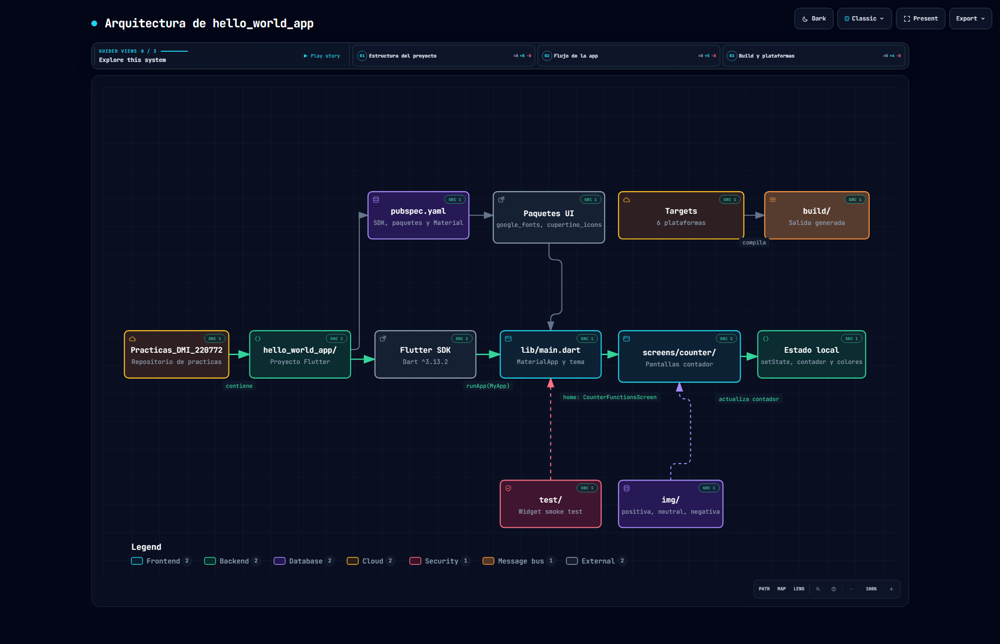
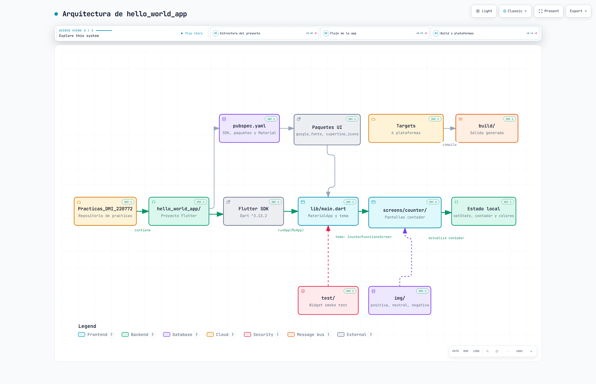
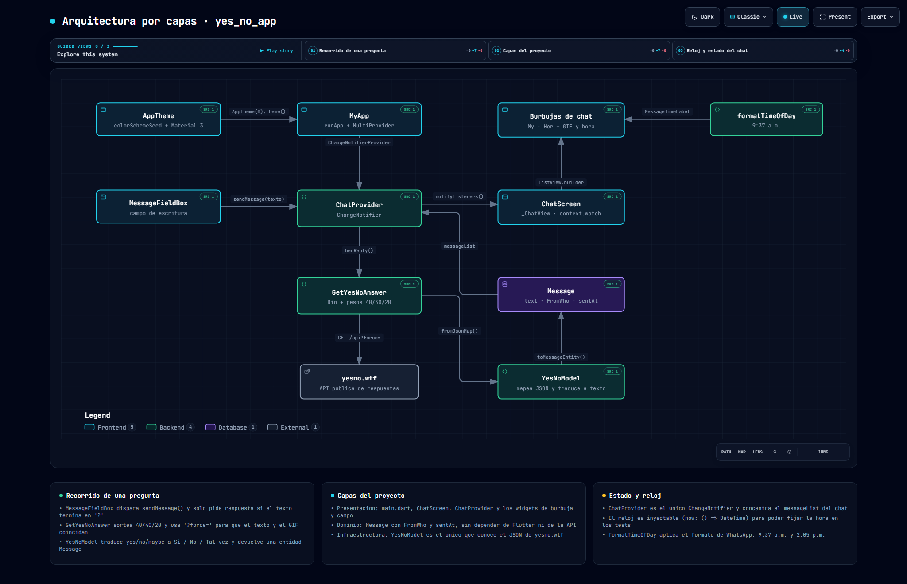
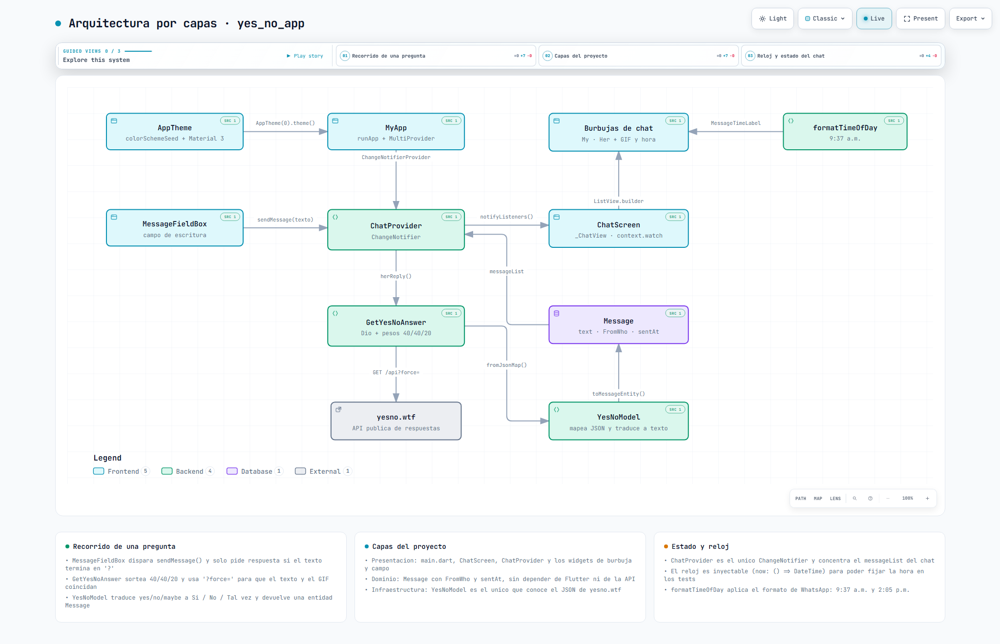
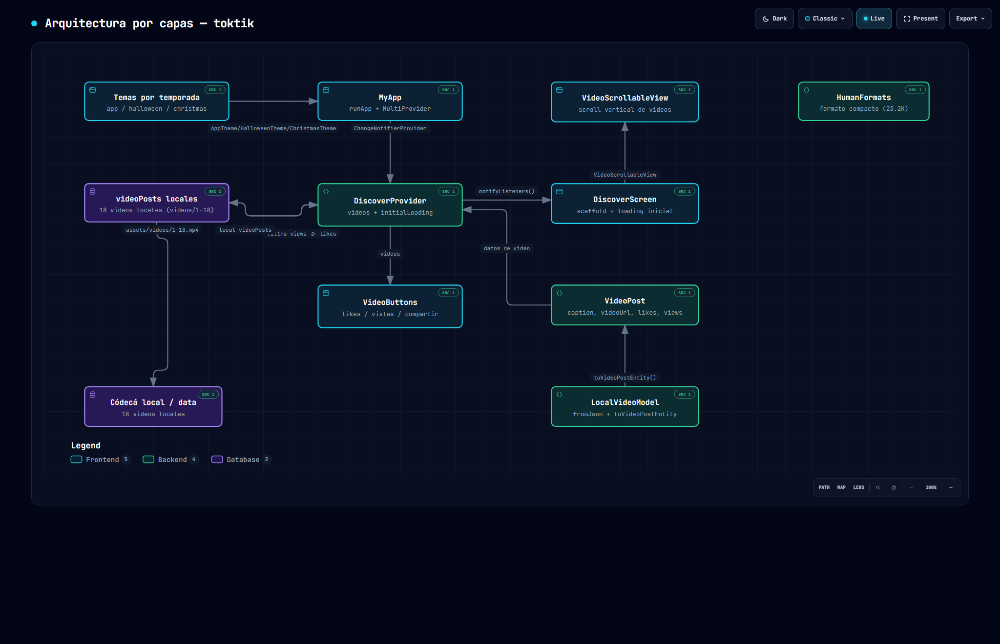
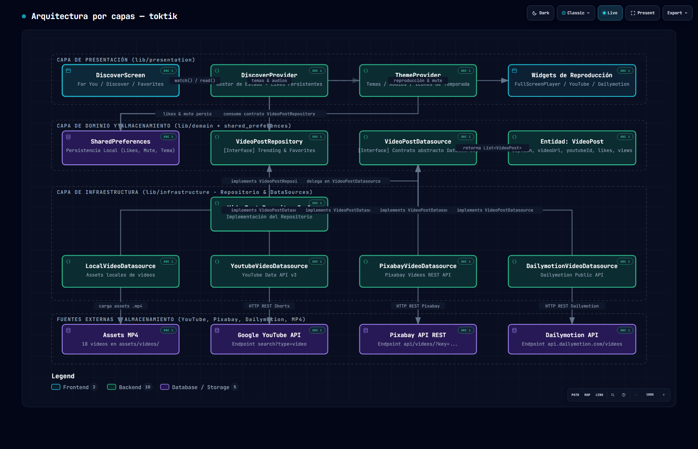
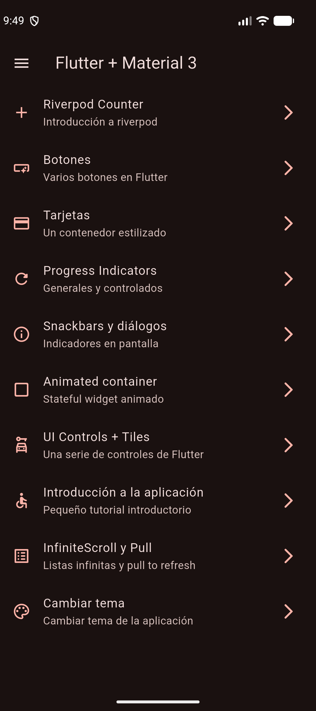

  

  # Prácticas de la Asignatura de Desarrollo Móvil Integral

  ## Ingeniería en Desarrollo y Gestión de Software

  **Estudiante:** Jesus Alejandro Artiaga Morales (Matrícula: 220772)  
  **Docente:** M.T.I. Marco A. Ramírez Hernández  
  **Periodo:** Septiembre - Diciembre 2026  

  
  

  🔗 **[https://jesuuusart.github.io/Practicas_DMI_220772/](https://jesuuusart.github.io/Practicas_DMI_220772/)**

---

### 📋 Tabla de Prácticas de la Materia

| No. | Nombre | Descripción | Potenciador | Estatus |
|:---:|:---|:---|:---:|:---:|
| 1. | Metodología de Evaluación de la Materia | Transcribir en libreta y comprender la metodología y fechas de evaluación de la asignatura | 5 | 🟢 Concluida |
| 2. | [Mi Primer Aplicación Móvil con Flutter](/Practica02/hello_world_app) | Codificar la app móvil en el framework de Flutter manejando Stateless y Stateful Widgets | 25 | 🟢 Concluida |
| 3. | [Yes No Maybe App](/Practica03/yes_no_app) | App de chat en Flutter que consulta la API yesno.wtf con arquitectura por capas, inyección de dependencias, 38 pruebas y 4 diagramas Archify | 30 | 🟢 Concluida |
| 4. | [TokTik](/Practica04/toktik) | App de videos estilo TikTok con scroll vertical, Clean Architecture, 4 temas por temporada, 3 DataSources remotos e iconos personalizados | 30 | 🟢 Concluida |
| 5. | [Widgets App](/Practica05/widgets_app) | Catálogo de componentes visuales e interactivos de Material Design 3 con GoRouter, Riverpod y AnimateDo | 40 | 🟢 Concluida |
| 5.1 | [Publicación de TokTik en Appetize.io](https://appetize.io/app/b_akk4ouahozbruc6pqrlrr3aaqy) | Compilación release y validación de ejecución virtual de TokTik en la nube vía Appetize | 10 | 🟢 Concluida |

---

### 📂 Proyectos y Diagramas de Arquitectura

- **[📱 hello_world_app](Practica02/hello_world_app/)** — Contador Funcional en Flutter ([📄 Documentación completa](Practica02/hello_world_app/README.md))
- **[💬 yes_no_app](Practica03/yes_no_app/)** — Yes No Maybe App en Flutter ([📄 Documentación completa](Practica03/yes_no_app/README.md))
- **[🎬 toktik](Practica04/toktik/)** — App de videos estilo TikTok en Flutter ([📖 Documentación completa](Practica04/toktik/README.md))
- **[🧩 widgets_app](Practica05/widgets_app/)** — Catálogo de Material 3 con GoRouter y Riverpod ([📄 Documentación completa](Practica05/widgets_app/README.md))
- **[☁️ Publicación en Appetize.io](https://appetize.io/app/b_akk4ouahozbruc6pqrlrr3aaqy)** — Ejecución de TokTik en emulador Android en la nube (10 Firmas)

  
<b>📱 Hello World App — Diagrama Archify (Haz clic para desplegar)</b>

   

  #### 🔗 Enlaces a Diagramas Interactivos:
  - 🌐 [Sitio Web Portafolio GitHub Pages](https://jesuuusart.github.io/Practicas_DMI_220772/)
  - 🌐 [Diagrama Nativo OpenCode Archify](Practica02/hello_world_app/Docs/Architecture/hello_world_app_architecture.html)
  - 🖥️ [Visualizador Principal (index.html)](index.html)

  #### 🖼️ Previsualización de Diagrama:
  | Modo Oscuro (Dark) | Modo Claro (Light) |
  |---|---|
  |  |  |

  
<b>💬 Yes No Maybe App — 4 Diagramas Archify (Haz clic para desplegar)</b>

   

  #### 🔗 Enlaces a Diagramas Interactivos:
  - 🏗️ [Arquitectura por capas](Practica03/yes_no_app/Docs/Architecture/yes_no_app_architecture.visual-check.1440x900.dark.png)
  - 🔄 [Secuencia de una respuesta](Practica03/yes_no_app/Docs/Architecture/yes_no_app_sequence.visual-check.1440x900.dark.png)
  - 🔁 [Ciclo de vida de un mensaje](Practica03/yes_no_app/Docs/Architecture/yes_no_app_lifecycle.visual-check.1440x900.dark.png)
  - 🧪 [Estrategia de pruebas](Practica03/yes_no_app/Docs/Architecture/yes_no_app_tests.visual-check.1440x900.dark.png)
  - 🌐 [Versión en GitHub Pages](https://jesuuusart.github.io/Practicas_DMI_220772/Practica03/yes_no_app/Docs/Architecture/yes_no_app_architecture.html)

  #### 🖼️ Previsualización del Diagrama de Arquitectura:
  | Modo Oscuro (Dark) | Modo Claro (Light) |
  |---|---|
  |  |  |

  
<b>🎬 TokTik — 2 Diagramas Archify (Haz clic para desplegar)</b>

   

  #### 🔗 Enlaces a Diagramas Interactivos en GitHub Pages:
  - 🏛️ [Diagrama 1: Provider Local (Interactivo)](https://jesuuusart.github.io/Practicas_DMI_220772/Practica04/toktik/Docs/Architecture/toktik_architecture.html)
  - 🏗️ [Diagrama 2: Clean Architecture con Repositorio y 3 APIs (Interactivo)](https://jesuuusart.github.io/Practicas_DMI_220772/Practica04/toktik/Docs/Architecture/toktik_clean_architecture.html)
  - 🌐 [Sitio Web Portafolio GitHub Pages](https://jesuuusart.github.io/Practicas_DMI_220772/)

  #### 🖼️ Previsualización de los Diagramas de Arquitectura (Clic para interactuar en GitHub Pages):
  | Diagrama 1: Provider Local (Oscuro) | Diagrama 2: Clean Architecture (Oscuro) |
  |---|---|
  |  |  |

  
<b>🧩 Widgets App — 2 Diagramas Archify (Haz clic para desplegar)</b>

   

  #### 🔗 Enlaces a Diagramas Interactivos en GitHub Pages:
  - 🏛️ [Diagrama 1: Arquitectura General Tecnológica (Interactivo)](https://jesuuusart.github.io/Practicas_DMI_220772/Practica05/widgets_app/Docs/Architecture/widgets_app_general_architecture.html)
  - 🏗️ [Diagrama 2: Pantallas, Rutas y Estados Riverpod (Interactivo)](https://jesuuusart.github.io/Practicas_DMI_220772/Practica05/widgets_app/Docs/Architecture/widgets_app_specific_architecture.html)
  - 📄 [Documentación Completa de Arquitectura](Practica05/widgets_app/Docs/Architecture/DIAGRAMAS_ARQUITECTURA.md)
  - 📖 [Documentación de Widgets App (Práctica 05)](Practica05/widgets_app/README.md)
  - 🌐 [Sitio Web Portafolio GitHub Pages](https://jesuuusart.github.io/Practicas_DMI_220772/)

  #### 🖼️ Evidencia de Ejecución en Emulador:
  

    
  

  
<b>☁️ Publicación de TokTik en Appetize.io — Ejecución en la Nube (Haz clic para desplegar)</b>

   

  #### 🔗 Acceso Directo al Emulador en la Nube:
  - 📱 **Enlace directo a Appetize.io:** [https://appetize.io/app/b_akk4ouahozbruc6pqrlrr3aaqy](https://appetize.io/app/b_akk4ouahozbruc6pqrlrr3aaqy)
  - 🌐 [Sitio Web Portafolio GitHub Pages](https://jesuuusart.github.io/Practicas_DMI_220772/)
  - 📖 [Documentación de TokTik (Práctica 04)](Practica04/toktik/README.md)

  #### ⚙️ Ficha Técnica de la Publicación:
  - **Plataforma:** [Appetize.io](https://appetize.io/)
  - **Dispositivo virtual:** Android Emulator en streaming interactivo WebRTC/HTML5
  - **Paquete compilado:** `app-release.apk` (Release Build optimizado con Flutter)
  - **Peso del APK:** ~135.4 MB
  - **Funcionalidades validadas en la nube:**
    - Desplazamiento vertical continuo de videos tipo TikTok (`PageView.builder`).
    - Selector interactivo de temas estacionales (Halloween, Navidad, San Valentín, Normal).
    - Desplazamiento horizontal entre pestañas (*Para ti*, *Descubrir* con APIs y *Favoritos*).
    - Reproducción de video, audio de temporada en segundo plano, mute/unmute y likes reactivos.

